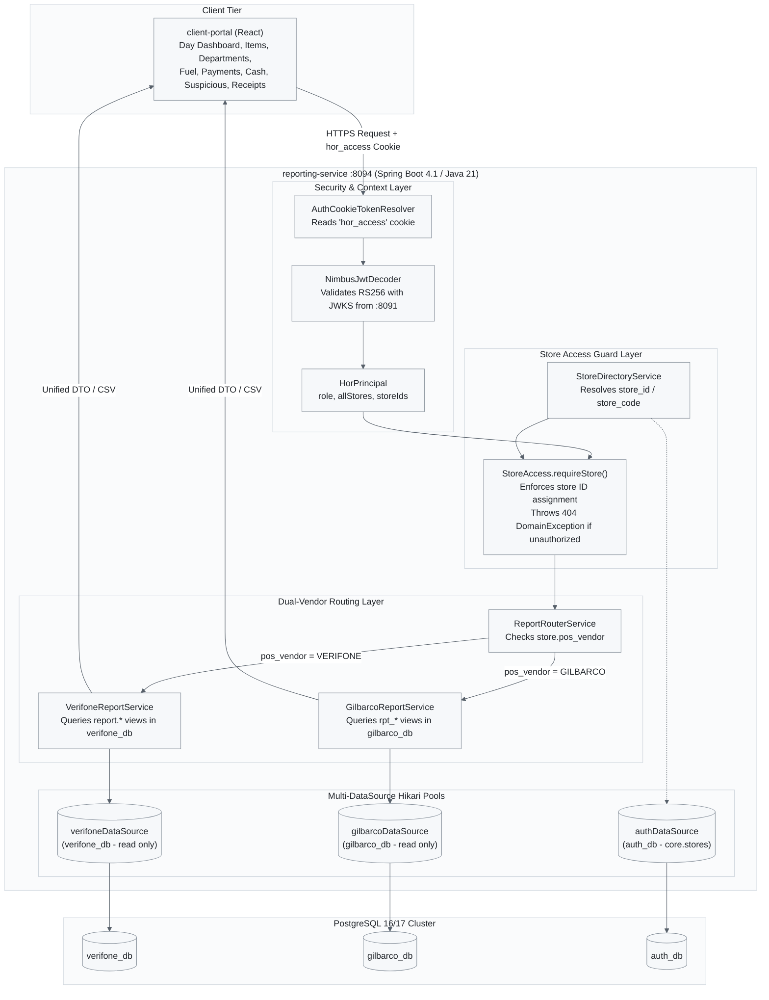

# reporting-service: Architecture & System Overview

**Service Port:** `8094`  
**Protocol:** HTTPS / JSON & UTF-8 CSV  
**Authentication:** RS256 JWT cookie (`hor_access`) validated via JWKS from `auth-service :8091`  
**Target Clients:** `client-portal` (React) & Platform Admin reporting

---

## 1. System Placement & Boundaries

The `reporting-service` sits exclusively on the **READ SIDE** of the Hands Off Retail platform:

```
[ Browsers: Platform Admin / Store Client / HOR Staff ]
                         │
                         ▼
        [ nginx :443 Reverse Proxy (Oracle Cloud VM) ]
                         │
        ┌────────────────┼────────────────────────┐
        │ /api/auth/     │ /api/ingestion/**      │ /api/reporting/
        ▼                ▼                        ▼
[ auth-service :8091 ]  [ verifone-ingestion :8092 ]  [ reporting-service :8094 ]
[ auth_db ]             [ gilbarco-ingestion :8093 ]            │ (read-only)
                        [ verifone_db / gilbarco_db ] ──────────┘
```

- **Write Side (Ingestion):** POS zips are fetched from AWS S3 (`hor-stores-data`) and parsed into `verifone_db` and `gilbarco_db`.
- **Read Side (Reporting):** `reporting-service` executes analytical read queries against `verifone_db` and `gilbarco_db` and provides reports for assigned stores.

---

## 2. Core Architecture Components



---

## 3. Multi-Tenancy & Store Access Isolation Rules

Security is built on three strict rules:
1. **Zero Trust Store Isolation:** A user only ever sees data from stores they are assigned in `auth_db.core.store_user_stores`.
2. **Opaque 404 on Unauthorized Access:** If a user requests a store they are not assigned, the service returns `404 Not Found` (`StoreAccess.requireStore`) rather than `403 Forbidden` so that existence of other clients' stores is never leaked.
3. **Platform Admin Super-Access:** When `principal.allStores()` is `true` (`PLATFORM_ADMIN`), the user has access across all stores in the platform.

---

## 4. Key Endpoints Summary

| Endpoint | Method | What it Returns |
|---|---|---|
| `/api/reports/date-range` | GET | List of accessible stores with their first and last business days and file counts |
| `/api/reports/day-summary` | GET | Daily executive summary: customers, item sales, fuel, lottery, tax, payments, cash movements, voids, counter ties |
| `/api/reports/items-sold` | GET | Scanned items and department rings: UPC, description, dept, units, gross, promotions, net |
| `/api/reports/departments` | GET | Sales by department and salesClass (`merchandise`, `lottery_sale`, `lottery_payout`, `fuel`) |
| `/api/reports/fuel` | GET | Fuel by grade: volume, dollar amount, sales count, loyalty discounts, average $/gallon |
| `/api/reports/payments` | GET | Tender reconciliation: CASH, CREDIT, DEBIT, EBT with sales vs refunds |
| `/api/reports/cash-movements`| GET | Register cash events: safe drops, paid-outs, safe loans with timestamps and register ID |
| `/api/reports/suspicious/events` | GET | Loss prevention audit log: no-sales, void lines, whole transaction voids, refunds |
| `/api/reports/suspicious/daily` | GET | Daily aggregate counts and amounts per suspicious event kind |
| `/api/reports/lottery` | GET | Lottery sales and lottery payouts side by side (un-netted) |
| `/api/reports/lottery-payouts` | GET | Lottery winning ticket payouts |
| `/api/reports/voids` | GET | Daily breakdown of void lines, voided units, transactions with voids, and whole voids |
| `/api/reports/payment-gaps` | GET | Transactions whose collected payments differ from line items + tax |
| `/api/tickets/{fileId}/{seq}` / `/api/events/{fileId}` | GET | Complete transaction drill-down: header, items, payments, taxes, related prepay/completion events |

All reports support `format=csv` which immediately streams UTF-8 CSV with BOM for Excel compatibility.

---

## 5. Related Documentation Links

- [Complete Implementation Plan](REPORTING_SERVICE_PLAN.md)
- [REST API Specification](api-specification.md)
- [Verifone vs Gilbarco Data Schema Mapping](data-schema-mapping.md)
- [Mermaid Architecture Diagram](reporting-architecture.mmd)
